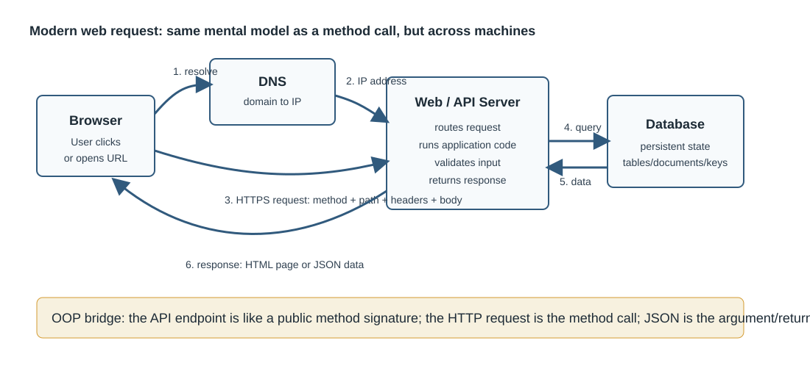
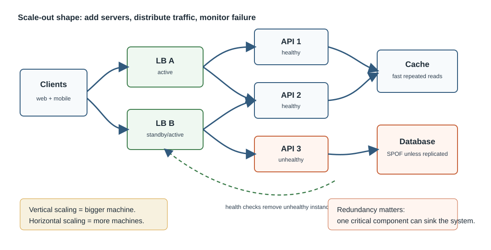
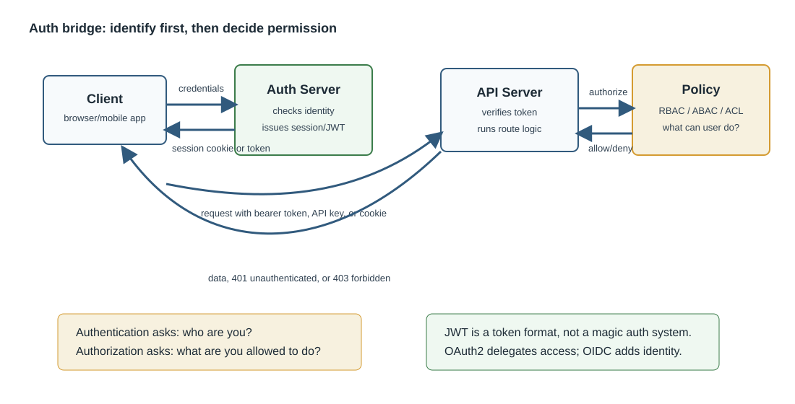

# System Design Lecture Notes for Experienced OOP Programmers

Source basis: local `transcript.txt`, a 2-hour system design course by Hayk Simonyan. These notes preserve the transcript's teaching arc but add beginner-oriented bridges for readers who know Java/Python/C/C++ classes, interfaces, memory, and process-level thinking but have little modern web application experience. The web-development bridges are instructional inferences, not external verification.

Use this package in order:

1. Read these notes once, end to end.
2. Open [system_design_learning_lab.html](system_design_learning_lab.html) for the clickable diagrams, API chooser, and quiz drills.
3. Do the exercises at the end of each module with a tiny imaginary app, such as a bookstore, photo album, task tracker, or bank ledger.

## 0. Translation Table: 90s OOP to Modern Web Apps

| OOP concept you know | Web-app equivalent | Why it matters |
|---|---|---|
| Public method signature | API endpoint contract | Other programs call your server through stable paths, methods, parameters, and response shapes. |
| Object state | Database row/document/cache entry | The app must survive process restart, so important state leaves RAM and goes into storage. |
| Interface implementation | Service/API implementation | Clients should depend on behavior and contract, not internal implementation details. |
| Constructor arguments | Request body/query/path params | The caller passes data into your system with HTTP request fields. |
| Exception/result code | HTTP status code and response body | Errors must be machine-readable across process and network boundaries. |
| Thread/process scheduling | Load balancing and horizontal scaling | Work is spread across machines, not just CPU threads. |
| Access modifiers | Authorization policy | Knowing who called you is separate from deciding what they may do. |

The transcript's core idea is simple: modern senior engineering requires understanding how components talk, fail, scale, and trade off, not only implementing local code.



## 1. The Smallest Web App: One Server, One User

A web app starts as a client-server interaction. A user opens a URL in a browser or mobile app. The client resolves the domain name to an IP address, sends an HTTP or HTTPS request, and receives a response. The server may return HTML/CSS/JavaScript for the browser or JSON data for an app.

The simplest architecture places everything on one machine:

- web server responsibilities: accept requests, route paths, return static files, return API responses;
- application responsibilities: validate input, run business logic, decide what to read or write;
- database responsibilities: persist state after the process exits;
- optional cache responsibilities: keep hot values in fast memory for repeated reads.

For an OOP reader, think of the client calling a method across the network:

```text
GET /products/123
```

is conceptually like:

```java
Product product = productService.getProduct(123);
```

The difference is that the call now crosses machines, uses a text/binary protocol, can fail in more ways, and must include enough information for the server to understand the request.

Quick quiz:

1. What part of `GET /products/123` acts like the method name?
2. Why is important user data not kept only in server memory?
3. What is the difference between returning HTML and returning JSON?

Exercise:

Sketch a one-server bookstore. Include a browser, server, database, and three API calls: list books, view book, create order.

## 2. Databases: SQL, NoSQL, Graph, and Key-Value

The transcript separates relational and non-relational storage. The beginner rule is: choose storage based on data shape, consistency needs, and access patterns.

SQL databases store data in tables and rows. They are strong when relationships matter and when transactions must preserve valid state. The transcript uses examples like PostgreSQL, MySQL, Oracle, and SQLite. SQL shines when you need joins, constraints, and transaction semantics such as atomicity, consistency, isolation, and durability.

Use SQL when:

- data is structured and relationship-heavy;
- correctness matters, such as orders, payments, balances, ledgers, inventory;
- you need joins across users, products, orders, invoices, and permissions.

NoSQL is an umbrella, not one technology. The transcript mentions:

- document stores, such as MongoDB, for JSON-like flexible records;
- wide-column stores, such as Cassandra, for massive write-heavy datasets;
- graph databases, such as Neo4j or Amazon Neptune, for relationship traversal;
- key-value stores, such as Redis or Memcached, for very fast lookup.

Use NoSQL when:

- data is semi-structured or changes shape often;
- low latency and high scale matter more than complex joins;
- the natural query is "give me value by key" or "traverse relationships."

OOP bridge: SQL is like a set of strongly shaped classes with relationships and invariants. Document storage is closer to flexible dictionaries or nested objects. A key-value cache is like a shared map, except it is remote, expires entries, and may be lost.

Quick quiz:

1. Why is a banking ledger usually a SQL-shaped problem?
2. Why might a recommendation event stream fit NoSQL?
3. What makes Redis different from a durable database?

Exercise:

For a photo-sharing app, choose a store for: user accounts, photo metadata, like counts, activity events, and "top 20 recent photos." Explain your choices in one sentence each.

## 3. Scaling: Bigger Machine vs More Machines

Vertical scaling means scale up: add CPU, memory, storage, or network capacity to one server. It is simple but limited. Eventually the machine has a maximum size, cost rises sharply, and one machine remains a single point of failure.

Horizontal scaling means scale out: add more servers and distribute work among them. It is the default direction for large systems because it improves capacity and fault tolerance, but it introduces coordination problems.



The transcript's key pattern is:

```text
clients -> load balancer -> multiple API servers -> data layer
```

A load balancer distributes incoming traffic. The transcript covers common strategies:

| Strategy | Plain-English meaning | Use when |
|---|---|---|
| Round robin | Send requests to servers in order | Similar servers, simple traffic |
| Least connections | Prefer server with fewer active connections | Requests vary in duration |
| Least response time | Prefer fastest responding server | Performance differs dynamically |
| IP hash | Same client IP tends to same server | Session affinity helps |
| Weighted algorithms | Bigger servers receive more traffic | Server capacity differs |
| Geolocation | Route user to nearby region | Global latency matters |
| Consistent hashing | Map keys to nodes with minimal reshuffling | Caches and distributed storage |

Health checks let the load balancer detect when a server is unhealthy and stop sending traffic to it. This is the web version of not calling a broken object, except the broken component may be an entire machine.

Quick quiz:

1. Why does horizontal scaling usually need a load balancer?
2. What problem do health checks solve?
3. Why can a single database still be a single point of failure even when API servers are horizontally scaled?

Exercise:

Design a scaled task tracker. Start with one server, then add three API servers and a load balancer. Mark every component that can still take the whole system down.

## 4. Single Point of Failure

A single point of failure is any component whose failure brings down the whole system. The transcript highlights both databases and load balancers as examples. The lesson is not "duplicate everything immediately." The lesson is to know which components are critical and what happens when they fail.

Ways to reduce single points of failure include:

- redundancy: more than one load balancer, server, or database node;
- health checks: detect failure and route around it;
- monitoring: know when failure happens before users report it;
- self-healing: replace unhealthy instances automatically;
- replication/failover: keep data available if one database node fails.

OOP bridge: this is like removing a global singleton that every object depends on. If the singleton dies, the application dies. Distributed systems make these hidden dependencies more visible and more expensive.

Quick quiz:

1. Why can the load balancer itself become a risk?
2. What is the difference between detecting failure and recovering from it?
3. Which is more dangerous: one unhealthy API server behind a load balancer, or one unavailable primary database?

Exercise:

For your bookstore, list five failure scenarios and write the user-visible symptom for each.

## 5. API Design: Contracts Between Programs

An API is a contract that lets different systems communicate. The transcript emphasizes that API design is not just picking names. It includes resource modeling, request/response shape, security, versioning, performance, and lifecycle.

Good API design asks:

- What resource is the client trying to access?
- What action is allowed?
- What input is required?
- What output shape is promised?
- What error codes can happen?
- How will the contract evolve without breaking old clients?
- How will large lists be paginated, filtered, and sorted?

REST, GraphQL, and gRPC are different styles:

| Style | Shape | Best fit |
|---|---|---|
| REST | resource URLs plus HTTP methods | web/mobile APIs, CRUD-heavy systems, caching-friendly endpoints |
| GraphQL | one endpoint where clients ask for fields | clients need flexible nested data with fewer round trips |
| gRPC | typed remote procedure calls over HTTP/2 with protocol buffers | internal service-to-service communication where performance matters |

REST examples:

```http
GET /api/v1/users/123
GET /api/v1/users/123/posts?limit=20&offset=0
POST /api/v1/orders
PATCH /api/v1/orders/987
DELETE /api/v1/sessions/current
```

GraphQL example:

```graphql
query {
  user(id: "123") {
    name
    posts {
      title
      createdAt
    }
  }
}
```

The transcript warns that API performance and security are part of design, not add-ons. Use pagination for large lists. Validate input. Apply rate limiting. Keep contracts consistent.

Quick quiz:

1. Why might REST need three calls where GraphQL needs one?
2. Why can REST use HTTP caching more directly than GraphQL?
3. What is API versioning protecting?

Exercise:

Write a REST contract for a `Task` resource with fields `id`, `title`, `status`, and `ownerId`. Include create, update, list, and delete endpoints.

## 6. Protocols: HTTP, HTTPS, WebSockets, Queues, gRPC, TCP, UDP

The transcript separates application protocols from transport protocols.

Application layer:

- HTTP: request/response protocol for most web APIs;
- HTTPS: HTTP protected by TLS/SSL encryption;
- WebSockets: long-lived bidirectional connection for real-time updates;
- message queues: asynchronous producer-consumer communication;
- gRPC: high-performance RPC using HTTP/2 and protocol buffers.

Transport layer:

- TCP: reliable, ordered, delivery-checked, slower;
- UDP: faster, no delivery guarantee, useful when stale missing packets are acceptable.

Use TCP when correctness matters: payments, authentication, user data, standard APIs. Use UDP-like tradeoffs for live video, games, or streams where late data may be worse than missing data.

OOP bridge: HTTP is like a method call with a request object and response object. WebSockets are like keeping an object reference open for ongoing callbacks. Queues are like placing commands into a work list and letting another process handle them later.

Quick quiz:

1. Why is HTTPS the default for real applications?
2. Why does a chat app often need WebSockets?
3. Why is TCP usually right for login and payment requests?

Exercise:

For a live classroom app, choose protocols for login, fetching lecture notes, chat messages, video stream, and background email notifications.

## 7. RESTful APIs

REST uses resources and HTTP methods. The transcript's basic mapping is:

| HTTP method | Meaning |
|---|---|
| GET | retrieve data |
| POST | create data or trigger an action |
| PUT | replace a resource |
| PATCH | partially update a resource |
| DELETE | remove a resource |

HTTP status codes are part of the contract:

| Status | Meaning |
|---|---|
| 200 | success |
| 201 | created |
| 400 | bad request |
| 401 | unauthenticated |
| 403 | forbidden |
| 404 | not found |
| 429 | too many requests |
| 500 | server error |

Design tip for beginners: nouns in paths, verbs in methods.

```text
Good: POST /orders
Less good: /createOrder
```

That does not mean verb-style RPC is always wrong. It means REST has a resource-centered style, and consistency helps client programmers.

## 8. Authentication vs Authorization

Authentication answers: who is this caller?

Authorization answers: what may this caller do?



The transcript spends time cleaning up common confusion:

- JWT is a token format, not an authentication method by itself.
- A bearer token means whoever has the token can use it.
- OAuth2 is an authorization framework, not primarily an authentication method.
- OpenID Connect adds identity on top of OAuth2.
- Single sign-on is a user experience pattern that relies on identity protocols underneath.

Common authentication patterns:

| Pattern | Summary | Risk/tradeoff |
|---|---|---|
| Basic auth | username/password in header | only acceptable with HTTPS, still limited |
| Digest auth | challenge-response improvement over basic | less common in modern app flows |
| API key | random secret identifies app/client | leakage is serious; expiration must be designed |
| Session cookie | server stores session, client stores cookie | stateful; good for traditional web apps |
| Bearer/JWT | token sent on each request | stateless verification; protect token storage |
| Access + refresh tokens | short-lived access, longer-lived refresh | more moving parts, better security posture |

Authorization models:

| Model | Meaning | Example |
|---|---|---|
| RBAC | role-based access control | admin, editor, viewer |
| ABAC | attribute-based access control | user department, resource owner, time, region |
| ACL | access control list per resource | document has users with read/write permissions |

Quick quiz:

1. If a user is logged in but cannot delete a repository, is that an authentication failure or authorization denial?
2. Why should refresh tokens not be stored casually in browser local storage?
3. What extra identity information does OpenID Connect add on top of OAuth2?

Exercise:

Design roles for the bookstore: customer, support agent, inventory manager, admin. List three actions each role can or cannot perform.

## 9. Security Basics from the Transcript

The transcript covers several web security controls and attacks:

- HTTPS/TLS protects data in transit.
- Rate limiting slows brute force and abusive traffic.
- Web application firewalls can block suspicious patterns, such as unusual methods or SQL-injection-like input.
- VPNs can limit private APIs to trusted networks.
- CSRF tricks a logged-in browser into sending unwanted requests.
- XSS injects scripts into pages shown to other users.
- SQL injection sends malicious input that becomes part of a database command.

Beginner mental model: every API endpoint is a public method that strangers may call. Validate arguments, authenticate callers, authorize actions, rate-limit abuse, and encode output before rendering it in a browser.

Quick quiz:

1. Which attack is about malicious script execution in another user's browser?
2. Which attack abuses a logged-in browser's cookies?
3. Why is input validation not enough without authorization?

Exercise:

For a comment endpoint, write three protections against XSS and one protection against CSRF.

## 10. The Shortest Practical Onboarding Flow

If you are moving from traditional OOP to modern web apps, learn in this order:

1. HTTP request/response anatomy: method, URL, headers, body, status code.
2. REST resources and CRUD endpoints.
3. JSON as cross-language object serialization.
4. Database choice: SQL first for structured business apps; NoSQL/cache when access patterns demand it.
5. Stateless API servers and horizontal scaling.
6. Load balancers, health checks, and single points of failure.
7. Authentication vs authorization.
8. Basic security controls: HTTPS, input validation, rate limiting, CSRF, XSS, SQL injection.
9. When REST is not enough: WebSockets, queues, GraphQL, gRPC.

Capstone exercise:

Design a tiny online course platform. It must support users, courses, lessons, comments, enrollments, and admin publishing. Produce:

- one architecture sketch;
- a data-store choice for each major entity;
- five REST endpoints;
- one place where GraphQL might help;
- one real-time feature that might need WebSockets;
- one asynchronous job that might need a queue;
- one authentication flow;
- one authorization model;
- three failure scenarios;
- three security risks and mitigations.

Use the HTML lab for feedback prompts and quiz practice.
